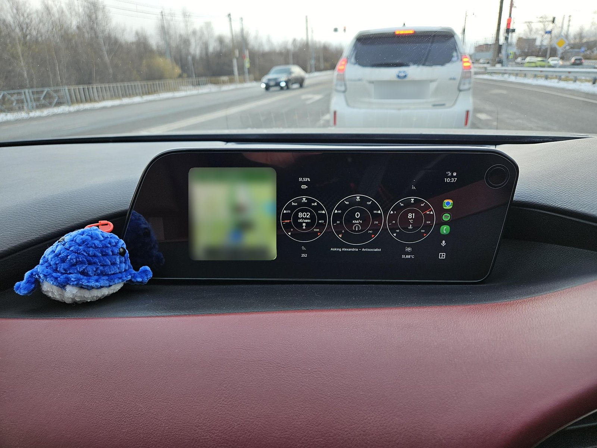
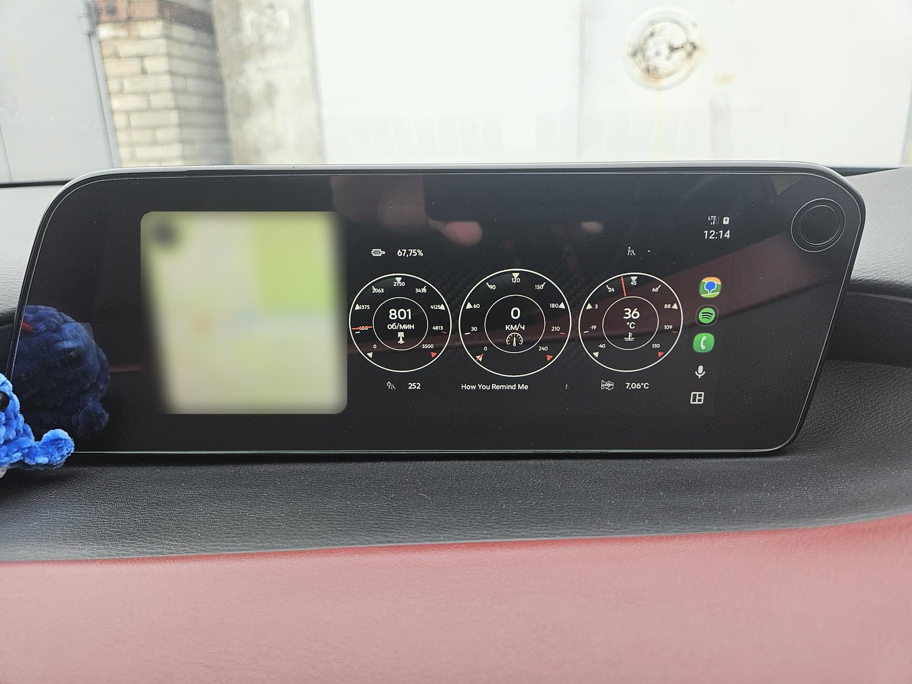
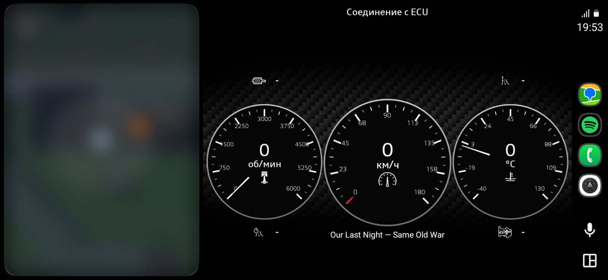

<!-- fork-notice -->
[Русский](README.md) | **English**

# AA Mazda Monitor

> **EN:** AA Mazda Monitor is a modified fork of [AA Torque](https://github.com/agronick/aa-torque) by Kyle Agronick, licensed under GPL-3.0 (see [`LICENSE.md`](LICENSE.md)). Modified in 2026 by Rilard-T: direct ELM327 connection (no Torque Pro needed), Mazda SkyActiv-D data, renamed app, BLE and Wi-Fi adapter support, own update channel. Icons are credited in the in-app Credits screen (CC BY 3.0, Noun Project).

A gauge dashboard on your car's screen via **Android Auto**. Unlike the original, the data comes **directly from an ELM327 adapter over Bluetooth/BLE/Wi-Fi**, so Torque Pro is not needed. The parameters are tuned for the **Mazda 3 (BP) 2020, SkyActiv-D 1.8 diesel**: diesel particulate filter (DPF) fill level, regeneration intervals, automatic transmission temperature.

Repository: <https://github.com/Rilard-T/AA-Mazda-Monitor> · Ready-made APKs: [Releases](https://github.com/Rilard-T/AA-Mazda-Monitor/releases)

> The app interface is available in Russian and English (it follows the phone's language): settings, the gauges, the OBD connection screen, the experimental features, link statuses, the notification and the sensor names.

---

## What it looks like

*On the car screen: navigation on the left, the gauges in the center (RPM, speed, temperature) with information tiles around them and the title of the playing track.*

*The same screen while parked.*

*A screenshot with a different gauge style, taken while connecting to the control unit (the "Соединение с ECU" / "Connecting to ECU" label).*

---

## What is changed compared to AA Torque

**Data and connection**
- Own adapter communication module (Bluetooth Classic, BLE and Wi-Fi) instead of Torque Pro: the app opens the channel itself, initializes the ELM327 and polls the control units.
- Mazda parameters (mode 22, confirmed on a 2020 Mazda 3 1.8 diesel): soot accumulation and generation (g/L), regeneration counter, distance since the last regeneration, automatic transmission oil temperature.
- Standard parameters: coolant temperature, RPM, speed, engine load, rail pressure, boost, air flow, intake and oil temperature, fuel level, system voltage, differential pressure across the particulate filter.
- Calculated: "DPF, %" (relative to a soot threshold, 6.5 g/L by default), interval between regenerations (the last one and the average of 5). The regeneration log is kept automatically.
- Slow sensors (transmission, soot and others) show the last good value (up to 30 seconds) instead of 0 on a single missed poll; the transmission request is retried right away. The reasons for missed readings are written to the log.
- A background service with a status notification and a "Stop" button, so the system does not unload it.

**Interface**
- The **"Settings"** button (a gear on the main screen toolbar, next to the info icon) opens the **"OBD connection"** screen: link status, adapter selection, start/stop, polling settings, soot threshold, sensor values for checking without the car.
- Polling settings: update rate for main and slow sensors, "faster adapter responses".
- An **"Exit"** button ("⋮" menu and the connection screen) and an exit confirmation on "Back" on the main screen.
- The information tiles **"View 1–4"** on the Android Auto screen are placed around the gauges: "View 1" above the left gauge, "View 2" above the right one, "View 3" below the left one, "View 4" below the right one. Labels are no longer cut off: they wrap onto a second line, and the values are larger. When an icon (rather than a text label) is chosen for an element, the icon and the value are shown on one line, centered under the gauge.
- The **"Element sizes"** settings: size of the gauges, tile values and tile labels (50–150%) and a "Hide top row" switch. Sizes change how elements look, not where they sit on the screen, so heavily enlarged gauges may overlap the tiles.
- The **"Now playing"** option (Settings → Media, off by default): shows the artist and the title of the playing track under the center gauge. It works with players that publish a system media session (Spotify, Yandex Music, Poweramp, the system player) and needs notification access.
- The **"⋮ → Report a problem"** button: opens a new issue page in this repository with the app version, phone model and the last lines of the log (Bluetooth addresses and VIN are hidden); the full log is copied to the clipboard. There is no automatic sending, nothing leaves the phone without your action.
- The interface is translated into Russian (settings, panels, elements, themes).
- The app is renamed to **AA Mazda Monitor**, package `com.aamazda.monitor`. The "About" window is updated: the author of the modification and a change notice are added, the donation button is removed, and the sources and icon authors are kept.

**Updates**
- Over-the-air updates come from the **Releases of this repository** ("⋮ → Check for updates"). The version is compared with the tag of the latest release (like `0.7.2`), pre-releases are ignored.
- All releases are signed with the same key and the version code (`versionCode`) only grows, so a new version installs **over** the old one without uninstalling and without losing settings.
- Versions before 0.6.0 computed the version code with a different formula; since 0.6.0 it is `major × 100000 + minor × 1000 + patch`.

---

## Quick start

1. **Adapter.** Plug the ELM327 (Bluetooth Classic) into the diagnostic port, turn on the ignition or start the engine.
2. **Pairing.** In your phone's Bluetooth settings find the adapter (usually `OBDII`, PIN `1234` or `0000`) and pair it.
3. **Installation.** Download the APK from [Releases](https://github.com/Rilard-T/AA-Mazda-Monitor/releases) and install it with Shizuku and AAEnabler (details below). Without this the app will not appear in the Android Auto app list.
4. **Permissions.** On first launch allow Bluetooth and notifications.
5. **Connection.** Tap **"Settings"** (the gear) on the main screen toolbar → choose the adapter (or leave "Automatic") → **"Start / connect"**. The "Adapter link" line should show "Connected", and sensor values appear below.
6. **Gauges.** In the app settings choose the parameters for the gauges (for example "Coolant temperature", "Soot accumulation", "Transmission oil temperature").
7. **Android Auto.** Enable developer mode once (in the Android Auto settings tap the version number ten times) and allow **"Unknown sources"**. Connect the phone to the car and open AA Mazda Monitor in the app list.

**Important:** the adapter holds one connection. Close any other OBD apps.

### Installing with Shizuku and AAEnabler

Android Auto lists only apps that were installed in a special way, so a regular APK install will not work. You need two apps:
- **Shizuku** (enables ADB on the phone itself), available on Google Play;
- **AAEnabler**: <https://github.com/malebuffy/AAEnabler>.

1. Install Shizuku and AAEnabler.
2. In Shizuku tap **"Pairing"** and follow the in-app instructions. Then tap **"Start"**.
3. Once Shizuku is running, an item showing the number of apps that request access appears ("X apps available" in the Russian interface). Open it and grant AAEnabler the permission.
4. Open AAEnabler, choose **"Select local APK"** and pick the downloaded APK. Under the button a card appears with the app name, version, SDK version and the line **"Android Auto metadata detected"**. If everything looks right, tap **"Install app"**.
5. Check that AA Mazda Monitor appears in the Android Auto app list.

> Shizuku is needed only during installation, not for running the app. Installing a new version via "Check for updates" may reset the install source, and the app will disappear from the Android Auto list. In that case repeat steps 2–5.

### If it does not connect

| Status message | What to do |
|---|---|
| Adapter not found | Pair the adapter in Bluetooth or select it manually in the list |
| No BLUETOOTH_CONNECT permission | Grant the permission to the app in Android settings |
| Could not open the Bluetooth channel | Turn on the ignition, close other OBD apps, wait 10 seconds |
| Engine control unit does not respond | Turn on the ignition or start the engine |
| Values are zero | Try turning off "Faster adapter responses" |

---

<!-- link-types -->
## Connection types

The type is chosen in "OBD connection → Connection type".
- **Bluetooth Classic** (default): the adapter is paired in the phone's Bluetooth settings and chosen in the "Adapter" list.
- **Bluetooth LE (BLE):** tap "Find BLE adapters" and choose the adapter from the list. Common adapters are supported (services FFF0, FFE0, 18F0, Nordic UART), others are detected automatically. BLE is usually slower than Classic.
- **Wi-Fi:** connect the phone to the adapter's network (a name like `WiFi_OBDII` or `V-LINK`), the default address is `192.168.0.10`, port `35000`. The app works specifically through the adapter's network, so mobile internet stays available. On Samsung turn off the automatic switch to mobile data, otherwise the phone may disconnect from a network without internet. A Wi-Fi adapter only suits wired Android Auto: with wireless Android Auto the phone's Wi-Fi is busy with the head unit link.

BLE and Wi-Fi connections are written to standard adapter schemes and have not been tested on every model. Please report problems via "⋮ → Report a problem".

## DPF fill percentage

The car reports soot accumulation in g/L, not in percent. For the "DPF, %" parameter the default threshold is **6.5 g/L**. This is an average value, and the real one for your car may differ. If the counter is wrong, use the **experimental features** (below): they record the soot at the moment a regeneration starts. You can enter your own threshold in **"OBD connection → Particulate filter → Soot threshold"**; an empty field means 6.5. To find it yourself, watch the "Soot accumulation" value for a few days and note the maximum before a regeneration (a regeneration is indicated by the regeneration status from the unit and a rising regeneration counter).

<!-- experimental-section -->
## Experimental features

The "⋮ → Experimental features" menu (and the "OBD connection" screen) collects data about **soot at the moment a regeneration starts**, until the real threshold for your engine is known:
- **Trigger:** the regeneration status reported by the engine unit (parameter `22 0380`: 0 — none, non-zero — a regeneration is running; values 1 and 2 are not distinguished yet). A regeneration is considered started when the status stays non-zero for 10 seconds and finished when it stays 0 for 10 minutes (under high engine load the unit may pause a regeneration for a while). At the start, the log records the maximum accumulated soot and the distance since the previous regeneration;
- **Record state:** "completed" (the regeneration counter grew, or the engine was switched off within 10 minutes after the regeneration ended) or "interrupted" (the engine was switched off during the regeneration, or the counter did not grow within 3 minutes after it ended). The remaining soot does not affect the state; after an interrupted regeneration the maximum soot since the last regeneration is counted anew from the current soot. The engine counts as switched off when the unit does not answer or there is no RPM for 10 seconds in a row. All completed regenerations take part in the average and the threshold. If the status briefly drops and returns (less than 10 minutes), it is the same regeneration and no new record is created. After the soot drops by half, the maximum soot since the last regeneration goes down with it and grows again as soot accumulates;
- if the app connected in the middle of a regeneration, nothing is recorded (the maximum soot is unknown); if the regeneration status is unavailable, the record is made from the counter growth;
- the "Apply as manual threshold" button, the "DPF % threshold from observations" mode and the gauge parameters "Soot before the last regeneration (exp.)", "Soot maximum since the last regeneration (exp.)".

Recording works only while the connection service is running (the app is started and the adapter is connected). The data is approximate: the soot accumulation in the unit is computed from the differential pressure across the filter.

## Feedback

Found a bug or have a suggestion? Use "⋮ → Report a problem" in the app or create an [issue](https://github.com/Rilard-T/AA-Mazda-Monitor/issues) manually. Include the app version, the phone and adapter models, the connection type and the log.

## Limitations

- ELM327 over **Bluetooth Classic**, **BLE** and **Wi-Fi** (BLE and Wi-Fi have not been tested on every adapter model).
- Reading and clearing trouble codes (DTC) is not supported.
- The parameters were checked on a 2020 Mazda 3 (S8DPTS 1.8L engine); they should work across the SkyActiv-D range, and the main PIDs should work on the vast majority of cars.
- The temperature before the particulate filter is not read: the 1.8 engine unit does not have this parameter (the 1.5 does).
- The difference between values 1 and 2 of the regeneration status (`22 0380`) is not confirmed on a car: a non-zero status accompanied a regeneration that started by itself at about 6.5 g/L of soot (one observation). On the "OBD connection" screen check the "Regeneration status (0/1/2)" line, it should show 0 outside a regeneration.
- The default soot threshold of 6.5 g/L is an average; the real threshold for the 1.8 is not determined yet. The unit may also start a regeneration by mileage regardless of soot; such regenerations lower the observed threshold.
- The "Now playing" line has not been tested with every player; after a pause the last track stays until the player is closed or the track changes.
- The Android Auto projection uses an unofficial interface. Android Auto updates may break it, and third-party APKs require developer mode.

## License and credits

- The project is distributed under **GPL-3.0** ([`LICENSE.md`](LICENSE.md)). The source code is available in this repository, and the changes are published under the same license.
- Original project: [AA Torque](https://github.com/agronick/aa-torque) by Kyle Agronick. Based on the Chillout app and the Martoreto SDK/demo. Acknowledgements and the list of translators are in the "About" window.
- Icons (CC BY 3.0, Noun Project): *Horse* — Peleg Red; *engine cylinder* — Thuy Nguyen; *transmission* — Gustyne Pissesa Ardhaneswari.
- Fork modification and maintenance: **Rilard-T**, 2026.
- Part of the code and documentation was prepared with the help of the AI assistant Claude (Anthropic); building, verification and testing were done by the author.
