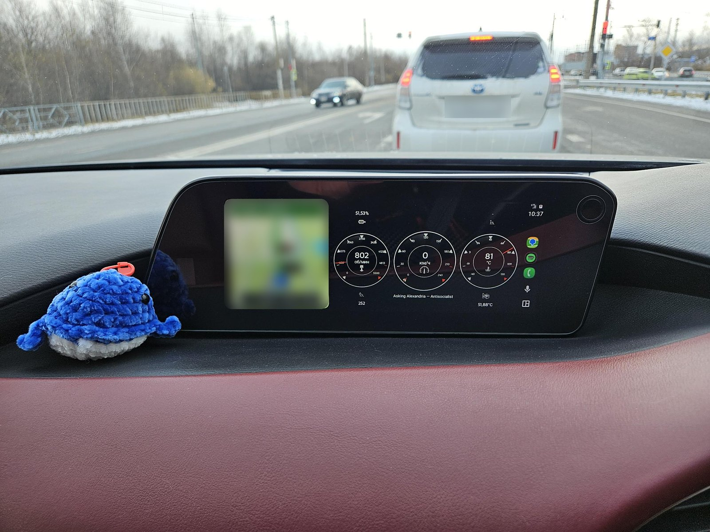
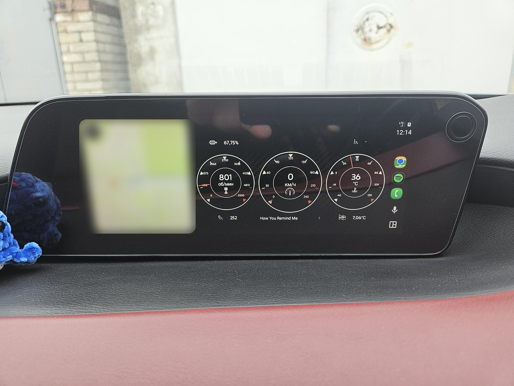
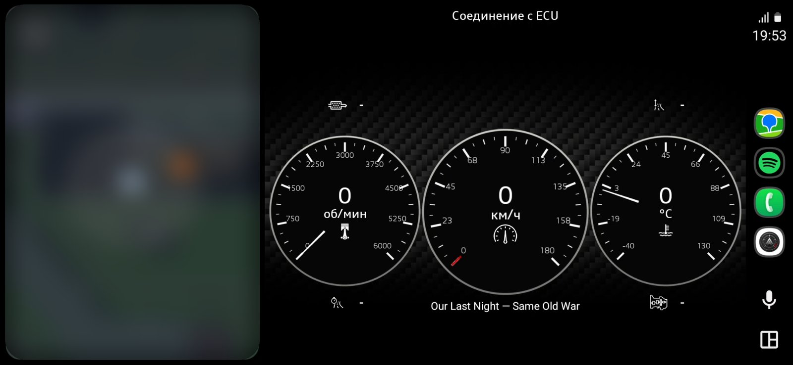
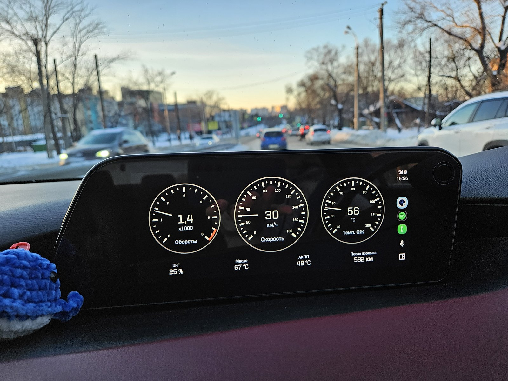
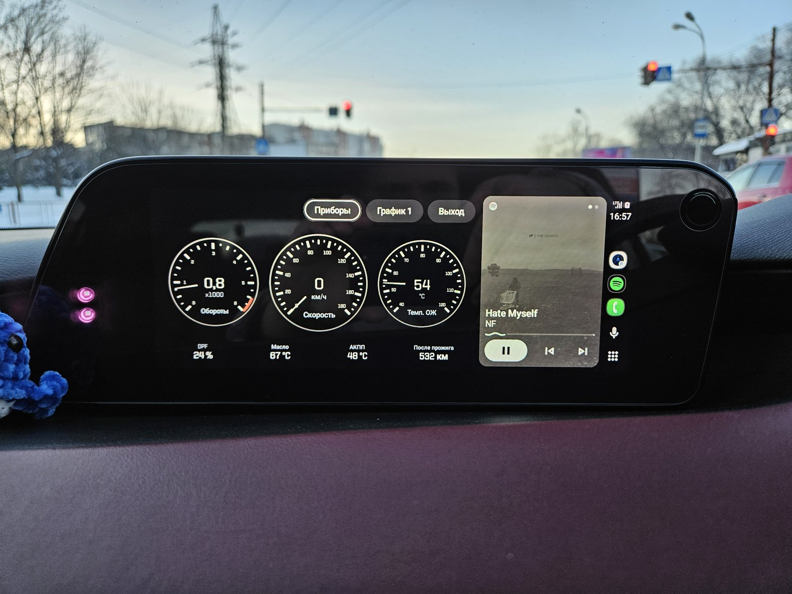
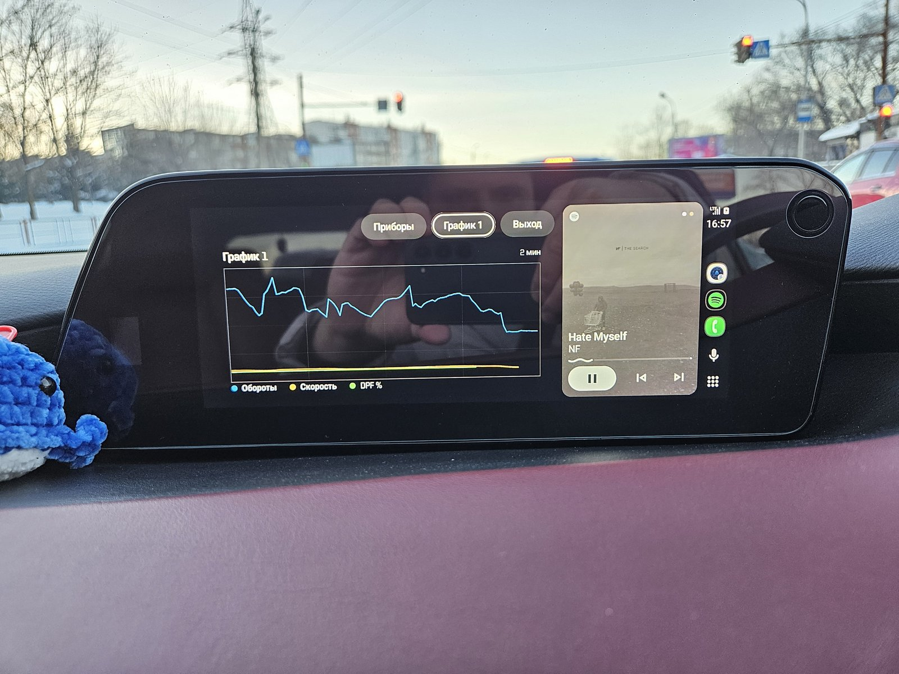

[Русский](README.md) | [English](README.en.md)

# AA Mazda Monitor and AA Dash Nav

Two **Android Auto** apps that show car data on the head unit screen. Both talk directly to an **ELM327** adapter over Bluetooth, BLE or Wi-Fi — no Torque Pro. Parameters are tuned for the **Mazda SkyActiv-D** diesel (verified on a Mazda 3 BP 2020, 1.8): DPF, regenerations, temperatures, boost, fuel consumption. The Mazda focus is a ready-made sensor set, not a restriction: the app is meant for any car that reports standard OBD-II parameters, and missing sensors can be added as custom PIDs.

[**AA Mazda Monitor**](#aa-mazda-monitor-master) is the mature app with a projected gauge dashboard. [**AA Dash Nav**](#aa-dash-nav-nav) is the newer app built on Car App Library templates, with a layout editor and graphs. They are two independent products: both can live on the same phone, and their settings and logs do not overlap.

[Download](#downloads) · [Which one](#which-one) · [Comparison](#the-two-apps-side-by-side) · [Installation](#installation) · [Adapter connection](#connecting-the-adapter) · [Repository map](#repository-map) · [All releases](https://github.com/Rilard-T/AA-Mazda-Monitor/releases) · [Issues](https://github.com/Rilard-T/AA-Mazda-Monitor/issues)

---

## Downloads

| App | APK | Release |
|---|---|---|
| **AA Mazda Monitor** (`master` branch) | [app-release.apk](https://github.com/Rilard-T/AA-Mazda-Monitor/releases/latest/download/app-release.apk) | [latest release](https://github.com/Rilard-T/AA-Mazda-Monitor/releases/latest) |
| **AA Dash Nav** (`nav` branch) | [app-nav-release.apk](https://github.com/Rilard-T/AA-Mazda-Monitor/releases/download/nav-latest/app-nav-release.apk) | [latest channel build](https://github.com/Rilard-T/AA-Mazda-Monitor/releases/tag/nav-latest) |

These links are permanent: they always point to the latest build of their channel, so they never need updating on release. All builds: [Releases](https://github.com/Rilard-T/AA-Mazda-Monitor/releases). Both are signed with the same key, so a new build installs over the previous one without uninstalling the app or losing settings.

---

## Which one

| What you want | App |
|---|---|
| Gauges on screen, familiar analog dials, the widest set of ready-made sensors and info tiles around the gauges | **AA Mazda Monitor** |
| Your own layout for wide and narrow screens, separate graph screens, tabs in the Android Auto UI | **AA Dash Nav** |
| Both | Install both: they do not conflict |

Both apps are free, open source and update from this repository.

---

## What it looks like

### AA Mazda Monitor (`master`)


*On the car screen: navigation on the left, gauges in the centre (RPM, speed, temperature), info tiles around them and the now-playing track line.*


*The same screen while parked.*


*Another gauge style and the moment of connecting to the engine unit ("Connecting to ECU").*

### AA Dash Nav (`nav`)


*Gauges on the car screen: RPM, speed and coolant temperature; below — DPF %, oil temperature, transmission temperature and distance since the last regeneration.*


*The same screen with the player: "Gauges", "Graph 1" and "Exit" tabs and the now-playing card.*


*A separate graph screen: RPM, speed and DPF % for the last 2 minutes.*

---

## The two apps side by side

These are not an "old" and a "new" version of one product, but two different approaches to the same screen.

**AA Mazda Monitor** draws the dashboard itself and projects it into Android Auto: the app controls every pixel, so the dials look like real analog gauges, with "View 1–4" info tiles and the track line around them. Element positions are fixed; only their sizes change.

**AA Dash Nav** uses the stock **Car App Library** templates: Android Auto draws the frame, tabs and cards, and the app fills them. The result looks more system-native and depends more on the Android Auto version, but it gains tab screens and a layout editor where gauges, values and media are placed by hand for wide and narrow screen shapes.

| | **AA Mazda Monitor** (`master`) | **AA Dash Nav** (`nav`) |
|---|---|---|
| Android Auto screen | projection of its own gauge dashboard | Car App Library templates: gauges, graphs, several tabs |
| Layout | fixed, with element size settings | editor: forms, proportions, elements, graphs, tools |
| Graphs | on the main screen | separate tab screens |
| Media | line under the centre gauge | now-playing card |
| Sensors and tiles | more ready-made "View 1–4" tiles, experimental soot tools | gauges, values and media in the layout, sensor per element |
| Package and icon | `com.aamazda.monitor`, dark dial | `com.aadash.nav`, blue dial with a **β** mark |
| Release tag and file | `0.9.0`, `app-release.apk` | `nav-<version>-<build number>`, `app-nav-release.apk` |
| Updates | latest regular release | latest `nav` channel release, build number is compared too |

Each channel has its own CI and releases; the `nav` branch is not merged into `master`.

---

## AA Mazda Monitor (`master`)

The workhorse: a projected gauge dashboard with parameter tiles around the gauges and the now-playing track under the centre gauge. Mazda parameters (`22` mode) are verified on a Mazda 3 2020 diesel 1.8: soot accumulation and generation, regeneration counter, distance since regeneration, transmission oil temperature.

**Features**

- Gauges and "View 1–4" info tiles on the Android Auto screen; gauge, value and label sizes 50–150%, hide the top row.
- **"OBD connection"** screen: link status, adapter selection, start/stop, polling rate, soot threshold, sensor check without a car.
- **Custom sensors and PID import** — add a sensor by hand or import a Torque Pro CSV; imported sensors are available on the gauges right away.
- The regeneration log is kept automatically; "DPF, %" is computed from the soot threshold (6.5 g/L by default).
- Experimental tools: record soot at regeneration start to find the real threshold for your engine.
- Now-playing track line (Settings → Media), notification access required.
- Problem report and full log export to `.txt` from the app.
- Russian and English UI, light and dark themes, wallpaper colours on Android 12+.
- Over-the-air updates from the regular releases of this repository.

Detailed description, a connection-error table and FAQ are in [`docs/AA_MAZDA_MONITOR.en.md`](docs/AA_MAZDA_MONITOR.en.md) ([Russian version](docs/AA_MAZDA_MONITOR.md)). Version history is in [`CHANGELOG.md`](CHANGELOG.md).

---

## AA Dash Nav (`nav`)

The app for those who want their own layout. The screen consists of tabs: gauges and graphs. Position, size and look of elements are configured in the editor; wide and narrow screen areas can have different layouts.

**Features**

- **Gauges on the Android Auto screen** — round dials and separate values, layouts for wide and narrow screen shapes.
- **Layout editor** — touch preview: drag, resize, align, grid and snapping, widget borders, add gauges, values and media.
- **Per-gauge setup** — sensor, scale maximum, red zone, dial size, labels and ticks; sensors can be copied to all forms with one command.
- **Graphs** — separate tab screens with selected sensors and a graph name.
- **Gauge themes** — 24 built-in themes and a flat look; font, ticks and a debug grid are switched in the editor.
- **Car profiles** — several profiles with their own settings, layout and log; the active profile is switched in settings.
- **App appearance** — light, dark or system theme, an accent colour picked from a palette (any hue, 5 quick presets), gauge and tile sizes, hiding the top row.
- **Media** — artist and track title on the Android Auto screen (notification access required).
- **DPF regeneration** — a status 1/2 banner in the header or first row, adjustable shift, size and colours, auto-hide after it ends; a regeneration log with export and import.
- **Over-the-air updates** — from the `nav` channel of this repository; version and build number are compared.
- **Custom sensors** — add a PID by hand or import a Torque Pro CSV; a new sensor is available in the layout and graphs right away.
- **Diagnostics** — a check of which PIDs answer, the full app log with `.txt` export and a problem report.

**Screen and editor.** The editor opens from settings: **"AA NAV dashboards" → "Gauge layout"**.

- **Form** — separate layouts for the wide and narrow screen area.
- **Proportions** — preview for the car screen, phone landscape or phone portrait.
- **Look** — gauge theme, font, ticks, debug grid, regeneration banner (enable, position, shift, size, background, text, border).
- **Elements** — add a gauge, value or media, align it, set widget borders.
- **Graphs** — create and configure graph screens and choose their sensors.
- **Tools** — grid, snapping, copying sensors to all forms, resetting the layout.

Long-press an element to open its menu, drag to move it, use the corner handle to resize. Do not forget to tap **"Save"**.

**Regeneration.** The regeneration status from the engine unit (`22 0380`) is shown as a banner: `0` — no regeneration, `1` or `2` — a regeneration is running. The banner can be placed in the header or the first row, and its shift, size and colours can be changed; it hides itself after the regeneration ends. The regeneration log is kept automatically; export and import are in settings, in the regeneration log section.

**Updates.** The app checks the releases of the `nav` channel; tags look like `nav-<version>-<build number>`, and the version and build number are compared. Manual check: **"About" → "Check for updates"**.

A short feature summary for release notes is in [`docs/NAV_FEATURES.md`](https://github.com/Rilard-T/AA-Mazda-Monitor/blob/nav/docs/NAV_FEATURES.md), the roadmap is in [`docs/PLAN_NAV.md`](https://github.com/Rilard-T/AA-Mazda-Monitor/blob/nav/docs/PLAN_NAV.md); both live in the `nav` branch.

---

## Installation

Android Auto only lists apps installed in a special way, so tapping an APK file will not work: use **AAEnabler** or **ADB from a PC** (the alternative method is below). The main path is installing the APK with **AAEnabler** (<https://github.com/malebuffy/AAEnabler>); the procedure is the same for both apps.

1. Install AAEnabler and allow it to install apps from this source.
2. Open AAEnabler → **"Select local APK"** → pick `app-release.apk` or `app-nav-release.apk`. A card with the app name, version, SDK and **"Android Auto metadata detected"** should appear. Tap **"Install app"**.
3. Enable developer mode in Android Auto (tap the version number ten times) and allow **"Unknown sources"**. The app will appear in the AA list.

**About Shizuku.** Installation used to require **Shizuku** (ADB on the phone itself, available on Google Play), and older instructions go through it: Shizuku → "Pairing" → "Start" → "X apps available" → grant the permission to AAEnabler. **Shizuku is not required now:** AAEnabler does not need it and installs the APK itself; permission to install from this source is enough. Shizuku remains a handy fallback if the installer misbehaves, and is useful for other ADB tasks.

> Updating via "Check for updates" may reset the install source; in that case repeat steps 1–3. You do not need to uninstall the app or lose settings.

### Alternative: installing over ADB from a PC

If AAEnabler does not work, the APK can be installed from a computer over a cable — no Shizuku and no AAEnabler. This works for both apps: `app-nav-release.apk` (`com.aadash.nav`) and `app-release.apk` (`com.aamazda.monitor`).

**What you need:** a PC (Windows, macOS or Linux), a USB data cable and Google's **platform-tools** — <https://developer.android.com/tools/releases/platform-tools>. Unpack the archive; `adb` is inside. Adding it to PATH is optional — you can run it from the folder (`adb` in PowerShell, `./adb` in a terminal). Download the APK from the [Downloads](#downloads) table.

1. **Enable USB debugging.** Settings → "About phone" → "Software information" → tap **"Build number"** seven times (that is how it works on Samsung). Then Settings → "Developer options" → **"USB debugging"**. Connect the phone with the cable and in the "Allow USB debugging?" dialog tick "Always allow" → **Allow**.
2. **Check the connection:** `adb devices` — the phone should be listed with the status `device`. A status of `unauthorized` means the dialog on the phone was not confirmed; an empty list means you need another cable or port. Without a cable (Android 11+): "Developer options" → "Wireless debugging" → "Pair device with pairing code" → `adb pair 192.168.x.x:port` with the code from the screen, then `adb connect 192.168.x.x:port`.
3. **Install the APK marked as "from Play".** Android Auto only lets apps recorded as installed from Google Play into its launcher, so the `-i com.android.vending` parameter matters:

   ```
   adb install -r -g -i com.android.vending <path to APK>
   ```

   Windows (PowerShell, from the platform-tools folder): `.\adb install -r -g -i com.android.vending "C:\Users\Name\Downloads\app-nav-release.apk"`. macOS and Linux: `./adb install -r -g -i com.android.vending ~/Downloads/app-nav-release.apk`. The flags: `-r` — reinstall over the existing app keeping settings, `-g` — grant permissions right away, `-i` — must come before the APK path. Success is the line `Success`.
4. **Verify the install source:** `adb shell dumpsys package com.aadash.nav | grep -i installer` (on Windows `findstr /i installer`). You should see `installerPackageName=com.android.vending`. If it is `null` or `com.android.packageinstaller`, the APK was not installed with this command — repeat step 3.
5. **Enable "Unknown sources" in Android Auto.** Phone Settings → Apps → Android Auto → "Additional settings in the app" (on some firmware: Settings → Connected devices → Android Auto). At the bottom open "About" → tap **"Version and permission info"** ten times → "Allow developer settings?" → OK. Then the "⋮" menu → **Developer settings** → **"Unknown sources"**.
6. **Restart Android Auto:** Settings → Apps → Android Auto → **Stop** (force stop), connect the phone to the head unit — the app appears in the car screen launcher (or in "Customise launcher" on the phone).

**If the app does not appear:** reboot the phone and reconnect AA; make sure it is a release APK rather than a debug build from Android Studio; repeat the install with `-r -g -i com.android.vending`; check the package (`adb shell pm list packages | grep aadash`) and what AA itself reports (`adb logcat | grep -iE "gearhead|CarApp|validate"`). The official fallback is Google Play → Internal app sharing: an install link from Play always passes the source check.

**Updates and removal.** Update with the same command, `adb install -r -g -i com.android.vending <new apk>`: tapping an APK in a file manager and the built-in "Check for updates" button both overwrite the install-source record, so repeat step 3 afterwards (data and settings are kept). To remove: `adb uninstall com.aadash.nav` or `adb uninstall com.aamazda.monitor`.

**Checking the launcher without a car:** in AA's developer settings enable **"Start head unit server"** and run the **DHU** emulator on the PC (`desktop-head-unit` from platform-tools) — Car App Library apps are visible there, so the install can be verified before going out to the car.

---

## Connecting the adapter

1. Plug the ELM327 into the diagnostic port and turn on the ignition or start the engine.
2. Pair the adapter in the phone's Bluetooth settings (usually `OBDII`, PIN `1234` or `0000`), or connect the phone to the adapter's Wi-Fi network.
3. In the app open **"OBD connection"**, choose the connection type and adapter, then tap **"Start / connect"**.
4. Wait for the "Connected" status and sensor values.

**Bluetooth Classic**, **BLE** and **Wi-Fi** are supported. The adapter holds one connection — close other OBD apps. To show the now-playing track, grant notification access (Settings → "Notification access (media)").

For Wi-Fi: the phone joins the adapter's network (usually `192.168.0.10`, port `35000`) and mobile data stays available. On Samsung, disable auto-switching to mobile data. With wireless Android Auto the phone's Wi-Fi is busy with the head unit, so only Bluetooth works there.

---

## Custom sensors and Torque Pro PID import

In both apps: **"OBD connection" → "Custom PIDs"**. A sensor can be added by hand — name, mode and PID in hex, formula, units, minimum and maximum — or loaded from a ready-made Torque Pro list.

- **CSV import.** The **"Import Torque CSV…"** button accepts a Torque Pro export (`Manage custom PIDs → Export`) with the columns `Name,ShortName,ModeAndPID,Equation,Min,Max,Units,Header`. The separator is a comma or a semicolon and is detected automatically; quotes and the header row are handled as in a normal CSV, and lines starting with `#` are skipped.
- **Torque formulas.** `A`…`P` are the response bytes; `SIGNED(x)`, `BIT(x,n)`, `INT(x)`, `ABS`, `MIN`, `MAX`, `ROUND`, `SQRT` work. Header `7E0` is the engine unit, `7E1` the transmission.
- **No duplicates.** Importing again updates sensors with the same "mode + PID" instead of adding copies.
- **Where they appear.** An imported sensor is immediately visible in "Sensor check", in the gauge PID picker and in the AA Dash Nav layout editor. Each sensor also has a one-shot "does the unit answer" test and a live value test.
- **Response bytes only.** Formulas that reference other sensors (for example `[0C]` in Torque notation) are **not supported yet**: a formula must be computed from the response bytes `A`…`P` and numeric constants. Such rows are skipped during import.

---

## Repository map

| Where | What is there |
|---|---|
| `master` | **AA Mazda Monitor**, the stable branch and the repository main page |
| `nav` | **AA Dash Nav**, a separate product and the `nav-…` update channel |
| [`app/`](app) | app sources; the `stable` flavor builds AA Mazda Monitor, `nav` builds AA Dash Nav |
| [`app/src/nav`](app/src/nav) | NAV variant resources: icon and name; [`app/src/stable`](app/src/stable) — AA Mazda Monitor resources; shared code lives in `app/src/main` |
| [`lib/speedviewlib`](lib/speedviewlib) | gauge library (SpeedView fork) |
| [`docs/screenshots`](docs/screenshots) | screen photos used in this README |
| [`docs/NAV_FEATURES.md`](https://github.com/Rilard-T/AA-Mazda-Monitor/blob/nav/docs/NAV_FEATURES.md) | short feature list of AA Dash Nav and its differences from AA Mazda Monitor (`nav` branch) |
| [`docs/PLAN_NAV.md`](https://github.com/Rilard-T/AA-Mazda-Monitor/blob/nav/docs/PLAN_NAV.md) | AA Dash Nav roadmap (`nav` branch) |
| [`docs/PID_PROFILES.md`](https://github.com/Rilard-T/AA-Mazda-Monitor/blob/nav/docs/PID_PROFILES.md) | how to add a sensor and prepare a PID profile for another SkyActiv-D model (`nav` branch) |
| [`docs/RELEASING.md`](docs/RELEASING.md) | release rules and the signing key (owner document) |
| [`docs/AA_MAZDA_MONITOR.en.md`](docs/AA_MAZDA_MONITOR.en.md) | full AA Mazda Monitor description: installation, connection types, experimental tools, FAQ; [Russian version](docs/AA_MAZDA_MONITOR.md) |
| [`docs/HANDOFF_MASTER.md`](docs/HANDOFF_MASTER.md), [`docs/NAV_TO_MASTER.md`](docs/NAV_TO_MASTER.md) | internal notes on moving `nav` changes into `master` |
| [`docs/release-notes-*.md`](docs) | AA Mazda Monitor release notes |
| [`CHANGELOG.md`](CHANGELOG.md) | AA Mazda Monitor version history |
| [`version.properties`](version.properties) | current version; bumped on release |
| [`.github/workflows`](.github/workflows) | CI: `build.yml`, `ci.yml`, `pr-checks.yml`, `release.yml`; the `nav` channel is built by `nav.yml` in the `nav` branch |
| [Releases](https://github.com/Rilard-T/AA-Mazda-Monitor/releases) | ready-to-install APKs for both apps |
| [Issues](https://github.com/Rilard-T/AA-Mazda-Monitor/issues) | bugs and suggestions |

Where to start: download an APK from the table above, install it with AAEnabler, connect the adapter. If something does not work, check the limitations below and [the AA Mazda Monitor description](docs/AA_MAZDA_MONITOR.en.md), which has a connection-message table and an FAQ.

---

## Limitations

- The parameters were verified on a **Mazda 3 (BP) 2020, SkyActiv-D 1.8**. Other SkyActiv-D models may have different PID sets, and some PIDs may not answer.
- The car does not have to be a Mazda: the basic sensors (RPM, speed, temperatures, boost, fuel consumption, voltage) come from standard OBD-II and work with any ELM327 adapter. Mazda-specific PIDs (`22` mode) simply will not answer on other makes; everything else keeps working.
- Reading and clearing trouble codes (DTC) is not supported.
- BLE and Wi-Fi have not been tested with every adapter model.
- The default 6.5 g/L soot threshold is an average; the unit may also start a regeneration by distance, so treat "DPF, %" as an estimate.
- Custom PIDs are computed from the response bytes only: formulas that reference other sensors are not supported yet.
- The media player needs notification access and system media session support in the player.
- The interface was checked on a real car head unit and a Samsung phone; other head units and Android Auto versions may lay out or size things differently.
- AA Mazda Monitor projects its dashboard through an unofficial Android Auto interface: Android Auto updates may break it.
- AA Dash Nav builds its screen on Car App Library templates, so its look depends on the Android Auto version and the head unit.

---

## Feedback

Bugs and suggestions: [Issues](https://github.com/Rilard-T/AA-Mazda-Monitor/issues) or **"⋮ → Report a problem"** in the app (AA Mazda Monitor) and the problem report in settings (AA Dash Nav). Include the app version, phone and adapter model, connection type and the log.

---

## License and credits

- The project is distributed under **GPL-3.0** ([`LICENSE.md`](LICENSE.md)). The source code is available in this repository, and the changes are published under the same license.
- Based on [AA Torque](https://github.com/agronick/aa-torque) by Kyle Agronick; the Chillout app and the Martoreto SDK/demo. Acknowledgements and translators are listed in the "About" window.
- Icons (CC BY 3.0, Noun Project): *Horse* — Peleg Red; *engine cylinder* — Thuy Nguyen; *transmission* — Gustyne Pissesa Ardhaneswari.
- Modification and maintenance: **Rilard-T**, 2026.
- Part of the code and documentation was prepared with the help of an AI assistant; building, verification and testing were done by the author.
