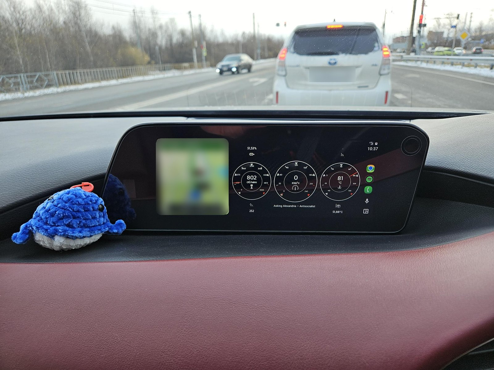
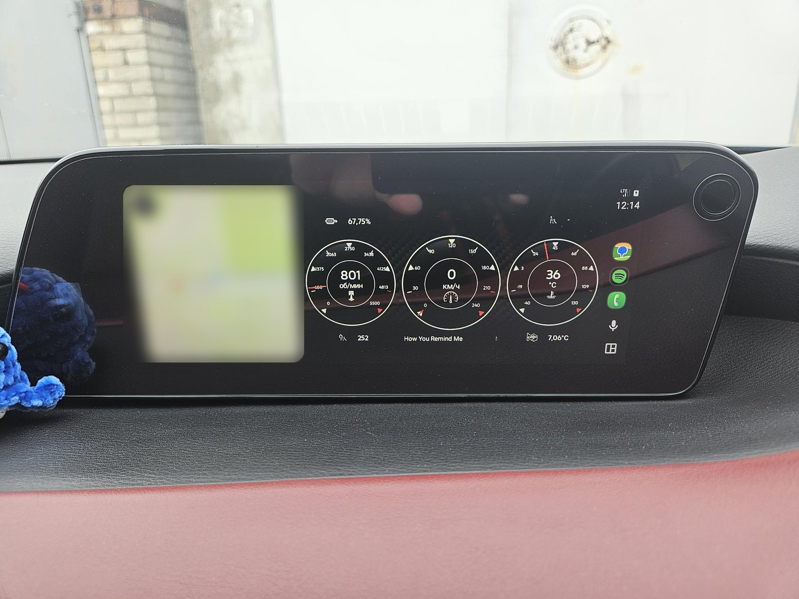
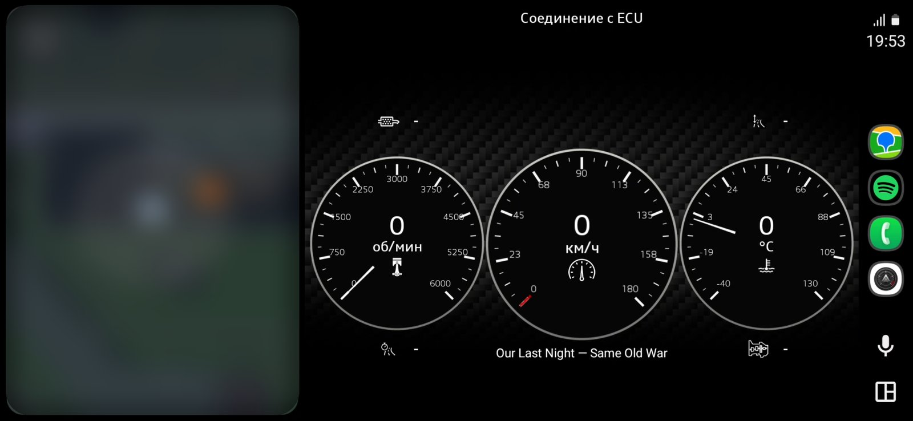
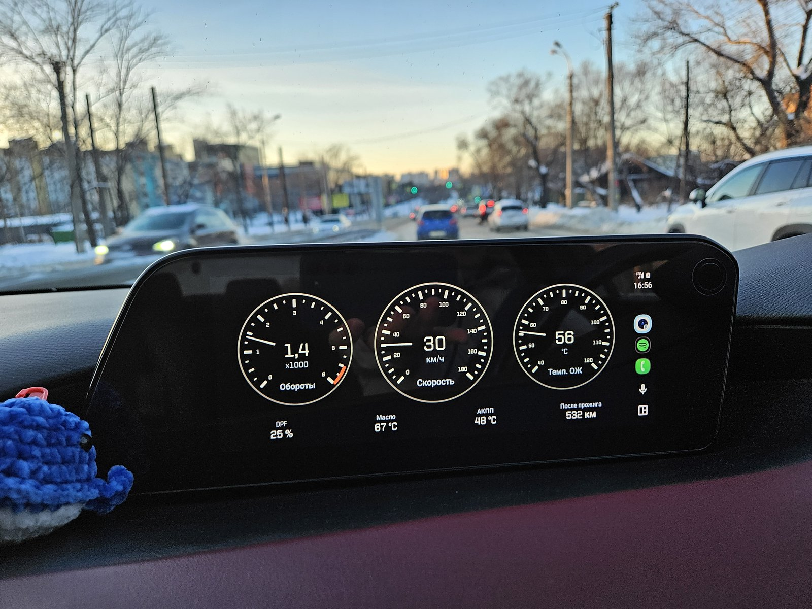
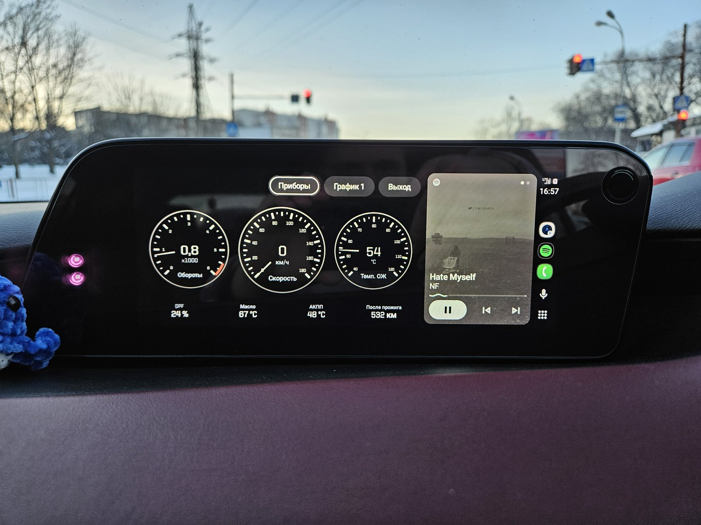
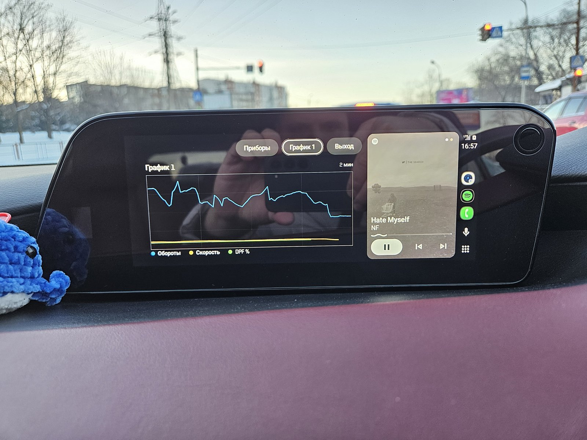

[Русский](README.md) | [English](README.en.md)

# AA Mazda Monitor и AA Dash Nav

Два приложения для **Android Auto**, которые показывают данные автомобиля на экране магнитолы. Оба работают напрямую с адаптером **ELM327** по Bluetooth, BLE или Wi-Fi, без Torque Pro. Параметры подобраны под дизель **Mazda SkyActiv-D** (проверено на Mazda 3 BP 2020, 1.8): сажевый фильтр, прожиги, температуры, наддув, расход. Привязка к Mazda — это готовый набор датчиков, а не ограничение: приложение рассчитано на любой автомобиль, который отдаёт стандартные параметры через OBD-II, а недостающие датчики добавляются своими PID.

[**AA Mazda Monitor**](#aa-mazda-monitor-master) — зрелое приложение с проекционной приборной панелью. [**AA Dash Nav**](#aa-dash-nav-nav) — новое приложение на шаблонах Car App Library с редактором раскладки и графиками. Это два независимых продукта: они могут стоять на одном телефоне, настройки и журналы у них не пересекаются.

[Скачать](#скачивание) · [Что выбрать](#что-выбрать) · [Сравнение](#два-приложения-в-чём-разница) · [Установка](#установка) · [Подключение адаптера](#подключение-к-адаптеру) · [Карта репозитория](#карта-репозитория) · [Все релизы](https://github.com/Rilard-T/AA-Mazda-Monitor/releases) · [Обращения](https://github.com/Rilard-T/AA-Mazda-Monitor/issues)

---

## Скачивание

| Приложение | APK | Релиз |
|---|---|---|
| **AA Mazda Monitor** (ветка `master`) | [app-release.apk](https://github.com/Rilard-T/AA-Mazda-Monitor/releases/latest/download/app-release.apk) | [последний релиз](https://github.com/Rilard-T/AA-Mazda-Monitor/releases/latest) |
| **AA Dash Nav** (ветка `nav`) | [app-nav-release.apk](https://github.com/Rilard-T/AA-Mazda-Monitor/releases/download/nav-latest/app-nav-release.apk) | [последняя сборка канала](https://github.com/Rilard-T/AA-Mazda-Monitor/releases/tag/nav-latest) |

Ссылки постоянные: всегда ведут на последнюю сборку своего канала, обновлять их при выпуске не нужно. Все сборки: [Releases](https://github.com/Rilard-T/AA-Mazda-Monitor/releases). Обе версии подписаны одним ключом, поэтому новая сборка ставится поверх предыдущей без удаления приложения и потери настроек.

---

## Что выбрать

| Задача | Приложение |
|---|---|
| Просто приборы на экране, привычный вид аналоговых шкал, максимум готовых датчиков и плиток вокруг приборов | **AA Mazda Monitor** |
| Своя раскладка под широкий и узкий экран, отдельные экраны-графики, вкладки в интерфейсе Android Auto | **AA Dash Nav** |
| Нужно и то и другое | Поставьте оба: они не конфликтуют |

Оба приложения бесплатны, с открытым исходным кодом и обновляются из этого репозитория.

---

## Как это выглядит

### AA Mazda Monitor (`master`)

*На экране автомобиля: слева навигация, в центре приборы (обороты, скорость, температура), вокруг — информационные плитки и строка играющего трека.*

*Тот же экран на стоянке.*

*Другой стиль приборов и момент подключения к блоку управления (надпись «Соединение с ECU»).*

### AA Dash Nav (`nav`)

*Приборы на экране автомобиля: обороты, скорость и температура ОЖ; ниже — DPF %, температура масла, температура АКПП и пробег после прожига.*

*Тот же экран с плеером: вкладки «Приборы», «График 1», «Выход» и карточка играющего трека.*

*Отдельный экран графика: обороты, скорость и DPF % за последние 2 минуты.*

---

## Два приложения: в чём разница

Это не «старая» и «новая» версии одного продукта, а два разных подхода к одному и тому же экрану.

**AA Mazda Monitor** рисует приборную панель сам и выводит её в Android Auto проекцией: приложение управляет каждым пикселем, поэтому шкалы выглядят как настоящие аналоговые приборы, а вокруг них стоят информационные окошки «Вид 1–4» и строка трека. Расположение элементов фиксировано, меняются только их размеры.

**AA Dash Nav** использует штатные шаблоны **Car App Library**: рамку, вкладки и карточки рисует сам Android Auto, а приложение наполняет их содержимым. Из-за этого интерфейс выглядит более системным и сильнее зависит от версии Android Auto, но получает вкладки-экраны и редактор раскладки, где приборы, значения и медиа расставляются вручную для широкой и узкой формы экрана.

| | **AA Mazda Monitor** (`master`) | **AA Dash Nav** (`nav`) |
|---|---|---|
| Экран в Android Auto | проекция собственной приборной панели | шаблоны Car App Library: приборы, графики, несколько вкладок |
| Раскладка | фиксированная, с настройкой размеров элементов | редактор: формы, пропорции, элементы, графики, инструменты |
| Графики | на общем экране | отдельные экраны-вкладки |
| Медиа | строка под центральным прибором | карточка играющего трека |
| Датчики и плитки | больше готовых плиток «Вид 1–4», экспериментальные функции по саже | приборы, значения и медиа в раскладке, выбор датчика для каждого элемента |
| Пакет и иконка | `com.aamazda.monitor`, тёмная шкала | `com.aadash.nav`, синяя шкала с меткой **β** |
| Тег релиза и файл | `0.9.0`, `app-release.apk` | `nav-<версия>-<номер сборки>`, `app-nav-release.apk` |
| Обновления | последний обычный релиз | последний релиз канала `nav`, сравниваются версия и номер сборки |

У каждого канала свой CI и свои релизы; ветка `nav` не сливается в `master`.

---

## AA Mazda Monitor (`master`)

Приложение-«рабочая лошадка»: проекционная приборная панель, вокруг приборов — плитки с параметрами, под центральным прибором — играющий трек. Параметры Mazda (режим `22`) подтверждены на Mazda 3 2020 дизель 1.8: накопление и генерация сажи, счётчик регенераций, пробег после прожига, температура масла АКПП.

**Возможности**

- Приборы и информационные окошки «Вид 1–4» на экране Android Auto; размеры приборов, значений и подписей 50–150%, скрытие верхней строки.
- Экран **«Подключение к OBD»**: статус связи, выбор адаптера, запуск и остановка, частота опроса, порог сажи, проверка датчиков без машины.
- **Свои датчики и импорт PID** — добавление датчика вручную или импорт CSV из Torque Pro; импортированные датчики сразу доступны на приборах.
- Журнал прожигов ведётся автоматически; «DPF, %» считается от порога сажи (по умолчанию 6,5 г/л).
- Экспериментальные функции: запись сажи в момент включения прожига, чтобы подобрать реальный порог для своего мотора.
- Строка играющего трека (Настройки → Медиа), доступ к уведомлениям.
- Отчёт об ошибке и экспорт полного журнала в `.txt` из приложения.
- Интерфейс на русском и английском, светлая и тёмная темы, цвета из обоев на Android 12+.
- Обновление по воздуху из обычных релизов этого репозитория.

Подробное описание, таблица ошибок подключения и частые вопросы — в [`docs/AA_MAZDA_MONITOR.md`](docs/AA_MAZDA_MONITOR.md) ([English](docs/AA_MAZDA_MONITOR.en.md)). История версий — в [`CHANGELOG.md`](CHANGELOG.md).

---

## AA Dash Nav (`nav`)

Приложение для тех, кому нужна своя раскладка. Экран состоит из вкладок: приборы и графики. Положение, размер и вид элементов настраиваются в редакторе; для широкой и узкой области экрана можно сделать разные раскладки.

**Возможности**

- **Приборы на экране Android Auto** — круглые шкалы и отдельные значения, раскладка для широкой и узкой формы экрана.
- **Редактор раскладки** — предпросмотр с касанием: перетаскивание, изменение размера, выравнивание, сетка и привязка к ней, границы виджетов, добавление приборов, значений и медиа.
- **Настройка каждого прибора** — датчик, максимум шкалы, красная зона, размер круга, подписи и деления; датчики можно скопировать во все формы одной командой.
- **Графики** — отдельные вкладки-экраны с выбранными датчиками и названием графика.
- **Темы приборов** — 24 готовых темы и плоский вид; шрифт, деления и отладочная сетка включаются в редакторе.
- **Профили автомобилей** — несколько профилей со своими настройками, раскладкой и журналом; активный профиль переключается в настройках.
- **Оформление приложения** — светлая, тёмная или системная тема, акцентный цвет палитрой (любой оттенок, 5 быстрых пресетов), размеры приборов и окошек, скрытие верхней строки.
- **Медиа** — исполнитель и название играющего трека на экране Android Auto (нужен доступ к уведомлениям).
- **Прожиг сажевого фильтра** — плашка со статусом 1/2 в шапке или первой строке, настраиваемые сдвиг, размер и цвета, автоскрытие после завершения; журнал прожигов с экспортом и импортом.
- **Обновление по воздуху** — из канала `nav` этого репозитория, сравниваются версия и номер сборки.
- **Свои датчики** — добавление PID вручную и импорт CSV из Torque Pro; новый датчик сразу доступен в раскладке и графиках.
- **Диагностика** — проверка, какие PID отвечают, полный журнал приложения с экспортом в `.txt` и отчёт об ошибке.

**Экран и редактор.** Редактор открывается из настроек: **«Дашборды AA NAV» → «Раскладка приборов»**.

- **Форма** — отдельные раскладки для широкой и узкой области экрана.
- **Пропорции** — предпросмотр под экран машины, телефон в альбомной или портретной ориентации.
- **Вид** — тема приборов, шрифт, деления, отладочная сетка, плашка прожига (включение, положение, сдвиг, размер, фон, текст, рамка).
- **Элементы** — добавить прибор, значение или медиа, выровнять, задать границы виджета.
- **Графики** — создать и настроить экраны-графики, выбрать для них датчики.
- **Инструменты** — сетка, привязка, копирование датчиков во все формы, сброс раскладки.

Удержание на элементе открывает меню, перетаскивание меняет положение, кружок в углу — размер. Не забудьте нажать **«Сохранить»**.

**Прожиг.** Статус прожига от блока (`22 0380`) показывается плашкой: `0` — прожига нет, `1` или `2` — прожиг идёт. Плашку можно поставить в шапку или в первую строку, изменить её сдвиг, размер и цвета; после завершения прожига она скрывается сама. Журнал прожигов ведётся автоматически, экспорт и импорт — в настройках, раздел журнала прожигов.

**Обновления.** Приложение проверяет релизы канала `nav`; теги имеют вид `nav-<версия>-<номер сборки>`, сравниваются версия и номер сборки. Проверка вручную: **«О приложении» → «Проверить обновления»**.

Краткая сводка возможностей для заметок к релизу — [`docs/NAV_FEATURES.md`](https://github.com/Rilard-T/AA-Mazda-Monitor/blob/nav/docs/NAV_FEATURES.md), планы развития — [`docs/PLAN_NAV.md`](https://github.com/Rilard-T/AA-Mazda-Monitor/blob/nav/docs/PLAN_NAV.md); оба документа живут в ветке `nav`.

---

## Установка

Android Auto показывает в списке только приложения, установленные особым способом, поэтому обычная установка APK тапом по файлу не подойдёт: нужен **AAEnabler**. Основной путь — установка через **AAEnabler** (<https://github.com/malebuffy/AAEnabler>); порядок одинаков для обоих приложений.

1. Установите AAEnabler и разрешите ему установку приложений из этого источника.
2. Откройте AAEnabler → **«Select local APK»** → выберите `app-release.apk` или `app-nav-release.apk`. Под кнопкой должно появиться название, версия, SDK и надпись **«Android Auto metadata detected»**. Нажмите **«Install app»**.
3. Включите в Android Auto режим разработчика (десять нажатий на номер версии) и разрешите **«Неизвестные источники»**. Приложение появится в списке AA.

**Про Shizuku.** Раньше для установки требовался **Shizuku** (ADB на самом телефоне, есть в Google Play), и в старых инструкциях шаги идут через него: Shizuku → «Сопряжение» → «Запустить» → «Доступно Х приложений» → выдать права AAEnabler. **Сейчас Shizuku не обязателен:** AAEnabler не требует его и ставит APK сам, достаточно разрешения на установку из этого источника. Shizuku остаётся удобным запасным путём, если установщик ведёт себя капризно.

> Обновление через «Проверить обновления» может сбросить запись об источнике установки — тогда повторите шаги 1–3. Удалять приложение и терять настройки при этом не нужно.

---

## Подключение к адаптеру

1. Вставьте ELM327 в диагностический разъём и включите зажигание или заведите двигатель.
2. Сопрягите адаптер в Bluetooth телефона (обычно `OBDII`, PIN `1234` или `0000`) либо подключите телефон к Wi-Fi сети адаптера.
3. В приложении откройте **«Подключение к OBD»**, выберите тип подключения и адаптер, нажмите **«Запустить / подключиться»**.
4. Дождитесь статуса «Подключено» и значений датчиков.

Поддерживаются **Bluetooth Classic**, **BLE** и **Wi-Fi**. Адаптер держит одно соединение — закройте другие OBD-программы. Для показа играющего трека разрешите приложению доступ к уведомлениям (Настройки → «Доступ к уведомлениям (медиа)»).

Для Wi-Fi: телефон подключается к сети адаптера (обычно `192.168.0.10`, порт `35000`), мобильный интернет при этом остаётся доступным. На Samsung отключите автопереключение на мобильные данные. При беспроводном Android Auto Wi-Fi телефона занят магнитолой — там подойдёт только Bluetooth.

---

## Свои датчики и импорт PID из Torque Pro

В обоих приложениях: **«Подключение к OBD» → «Свои датчики»**. Датчик можно добавить вручную — название, режим и PID в hex, формула, единицы, минимум и максимум — или загрузить готовый список из Torque Pro.

- **Импорт CSV.** Кнопка **«Импорт PID из CSV Torque Pro…»** принимает файл выгрузки Torque Pro (`Manage custom PIDs → Export`) с колонками `Name,ShortName,ModeAndPID,Equation,Min,Max,Units,Header`. Разделитель — запятая или точка с запятой, определяется автоматически; кавычки и строка заголовка обрабатываются как в обычном CSV, строки с `#` пропускаются.
- **Формулы Torque.** `A`…`P` — байты ответа; работают `SIGNED(x)`, `BIT(x,n)`, `INT(x)`, `ABS`, `MIN`, `MAX`, `ROUND`, `SQRT`. Заголовок `7E0` — блок двигателя, `7E1` — АКПП.
- **Без дубликатов.** Повторный импорт обновляет датчики с тем же «режим + PID», а не добавляет копии.
- **Где появляются.** Импортированный датчик сразу виден в «Проверке датчиков», в выборе PID для приборов и в редакторе раскладки AA Dash Nav. Для каждого датчика есть разовая проверка «отвечает ли блок» и живой тест значения.
- **Только байты ответа.** Формулы, которые ссылаются на другие датчики (например, `[0C]` в записи Torque), **пока не поддерживаются**: формула должна считаться из байтов ответа `A`…`P` и числовых констант. Такие строки при импорте пропускаются.

---

## Карта репозитория

| Где | Что там |
|---|---|
| `master` | **AA Mazda Monitor**, стабильная ветка и главная страница репозитория |
| `nav` | **AA Dash Nav**, отдельный продукт и канал обновлений `nav-…` |
| [`app/`](app) | исходники приложения; flavor `stable` собирает AA Mazda Monitor, `nav` — AA Dash Nav |
| [`app/src/nav`](app/src/nav) | ресурсы NAV-варианта: иконка и название; [`app/src/stable`](app/src/stable) — ресурсы AA Mazda Monitor; общий код — в `app/src/main` |
| [`lib/speedviewlib`](lib/speedviewlib) | библиотека приборов (форк SpeedView) |
| [`docs/screenshots`](docs/screenshots) | фотографии экранов из этого README |
| [`docs/NAV_FEATURES.md`](https://github.com/Rilard-T/AA-Mazda-Monitor/blob/nav/docs/NAV_FEATURES.md) | краткий список возможностей AA Dash Nav и отличий от AA Mazda Monitor (ветка `nav`) |
| [`docs/PLAN_NAV.md`](https://github.com/Rilard-T/AA-Mazda-Monitor/blob/nav/docs/PLAN_NAV.md) | план развития AA Dash Nav (ветка `nav`) |
| [`docs/PID_PROFILES.md`](https://github.com/Rilard-T/AA-Mazda-Monitor/blob/nav/docs/PID_PROFILES.md) | как добавить датчик и подготовить профиль PID для другой модели SkyActiv-D (ветка `nav`) |
| [`docs/RELEASING.md`](docs/RELEASING.md) | правила выпуска и ключ подписи (документ для владельца) |
| [`docs/AA_MAZDA_MONITOR.md`](docs/AA_MAZDA_MONITOR.md) | подробное описание AA Mazda Monitor: установка, типы подключения, экспериментальные функции, FAQ; [английская версия](docs/AA_MAZDA_MONITOR.en.md) |
| [`docs/MASTER_TO_NAV.md`](docs/MASTER_TO_NAV.md), [`docs/NAV_TO_MASTER.md`](docs/NAV_TO_MASTER.md) | служебные заметки обмена изменениями между `master` и `nav` |
| [`docs/release-notes-*.md`](docs) | тексты заметок к релизам AA Mazda Monitor |
| [`CHANGELOG.md`](CHANGELOG.md) | история версий AA Mazda Monitor |
| [`version.properties`](version.properties) | текущая версия; поднимается при выпуске |
| [`.github/workflows`](.github/workflows) | CI: `build.yml`, `ci.yml`, `pr-checks.yml`, `release.yml`; канал `nav` собирается `nav.yml` в ветке `nav` |
| [Releases](https://github.com/Rilard-T/AA-Mazda-Monitor/releases) | готовые APK обоих приложений |
| [Issues](https://github.com/Rilard-T/AA-Mazda-Monitor/issues) | ошибки и предложения |

С чего начать: скачайте APK из таблицы выше, поставьте его через AAEnabler, подключите адаптер. Если что-то не работает — загляните в ограничения ниже и в [подробное описание AA Mazda Monitor](docs/AA_MAZDA_MONITOR.md), там есть таблица сообщений о подключении и частые вопросы.

---

## Ограничения

- Параметры проверены на **Mazda 3 (BP) 2020, SkyActiv-D 1.8**. На других моделях SkyActiv-D наборы PID могут отличаться; часть PID может не отвечать.
- Автомобиль не обязан быть Mazda: базовые датчики (обороты, скорость, температуры, наддув, расход, напряжение) читаются по стандарту OBD-II с любым адаптером ELM327. Фирменные PID Mazda (режим `22`) на других марках просто не ответят, остальное работает.
- Чтение и сброс ошибок (DTC) не поддерживаются.
- BLE и Wi-Fi проверены не на всех моделях адаптеров.
- Порог сажи 6,5 г/л по умолчанию — среднее значение; блок может запускать прожиг и по пробегу, поэтому «DPF, %» стоит воспринимать как оценку.
- Свои PID считаются только из байтов ответа: формулы со ссылками на другие датчики пока не поддерживаются.
- Для медиаплеера нужен доступ к уведомлениям и поддержка системного медиауправления в плеере.
- Интерфейс проверен на реальном экране автомобиля и телефоне Samsung; на других магнитолах и версиях Android Auto расположение и размеры могут отличаться.
- AA Mazda Monitor выводит панель проекцией через неофициальный интерфейс Android Auto: обновления AA могут его нарушить.
- AA Dash Nav строит экран на шаблонах Car App Library, поэтому его вид зависит от версии Android Auto и головного устройства.

---

## Обратная связь

Ошибки и предложения — в [Issues](https://github.com/Rilard-T/AA-Mazda-Monitor/issues) или через **«⋮ → Сообщить об ошибке»** в приложении (AA Mazda Monitor) и отчёт об ошибке в настройках (AA Dash Nav). Приложите версию приложения, модель телефона и адаптера, тип подключения и журнал.

---

## Лицензия и авторы

- Проект распространяется под **GPL-3.0** ([`LICENSE.md`](LICENSE.md)). Исходный код доступен в этом репозитории, изменения опубликованы под той же лицензией.
- Основа: [AA Torque](https://github.com/agronick/aa-torque), Kyle Agronick; приложение Chillout и SDK/демо Martoreto. Благодарности и переводчики — в окне «О приложении».
- Иконки (CC BY 3.0, Noun Project): *Horse* — Peleg Red; *engine cylinder* — Thuy Nguyen; *transmission* — Gustyne Pissesa Ardhaneswari.
- Доработка и сопровождение: **Rilard-T**, 2026.
- Часть кода и документации подготовлена с помощью ИИ-ассистента; сборка, проверка и тестирование выполнены автором.
